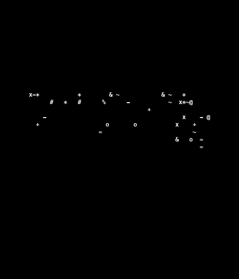
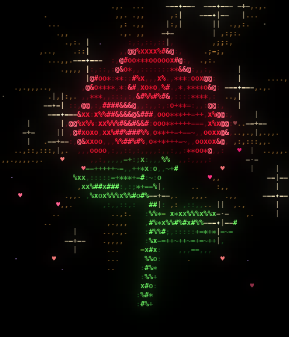

<div align="center">

# ♥ &nbsp;S p e c i a l &nbsp; L e t t e r&nbsp; ♥

<sub>✦ &nbsp; a little love letter, written entirely in characters &nbsp; ✦</sub>

<br>



<br>
<br>

*Some things are too soft for words,*<br>
*so this one is made of letters instead.*

<br>


</div>

<br>

---

<br>

## 💌 &nbsp;What it is

A tiny animated love letter that lives in a window. Every pixel you see is a
character — `.,:;-~=+*ox%#&@` — painted in warm paper tones, deep crimson and
soft gold. Run it, turn the screen toward someone, and let it play.

<br>

## 🌹 &nbsp;The story it tells

<table>
<tr>
<td width="50%" valign="top">

| &nbsp; | moment |
|:--:|:--|
| ✉️ | an envelope drifts in from the stars |
| ⌨️ | the words **f o r &nbsp; y o u** are typed inside |
| 🖱️ | a little cursor comes to open it |
| 💗 | the flap lifts, a heart beats |
| 🌹 | a rose rises and blooms |
| ✨ | golden light and sparkles fill the night |

</td>
<td width="50%" align="center" valign="middle">



</td>
</tr>
</table>

<br>

## 🕯️ &nbsp;How to open it

```bash
# 1. get the letter
git clone https://github.com/arditbe/SpecialLetter.git
cd SpecialLetter

# 2. give it what it needs
python3 -m venv .venv
source .venv/bin/activate
pip install numpy pillow

# 3. open it ♥
python love_letter.py
```

> [!TIP]
> On macOS, use a Python with **Tk 8.6+** (for example Homebrew's `python3`).
> Older system Pythons show a blank window.

<br>

## 🎀 &nbsp;While it's playing

<div align="center">

| key | what it does |
|:---:|:---|
| <kbd>Space</kbd> / <kbd>R</kbd> | play the letter again from the start |
| <kbd>F</kbd> | full screen, for the big moment |
| <kbd>Esc</kbd> / <kbd>Q</kbd> | close the letter |

</div>

<br>

## 🖋️ &nbsp;Make it yours

Everything personal sits at the top of `love_letter.py`:

```python
MESSAGE = "for you"   # the words inside the envelope
SPEED   = 1.5         # higher = faster, lower = slower and dreamier
FPS     = 60          # frame rate
```

The colors are there too (`ROSE_MID`, `PAPER`, `RAY_GOLD`, …) if you'd rather
send a golden rose or a pale pink envelope.

Want a still image to send instead? Grab any moment as a PNG:

```bash
python love_letter.py --snap 3.5,8.0
```

<br>

---

<div align="center">

<br>

<sub>made late at night, with a lot of ♥</sub>

<br>

**✦ &nbsp; send this to your love &nbsp; ✦**

<br>

</div>
